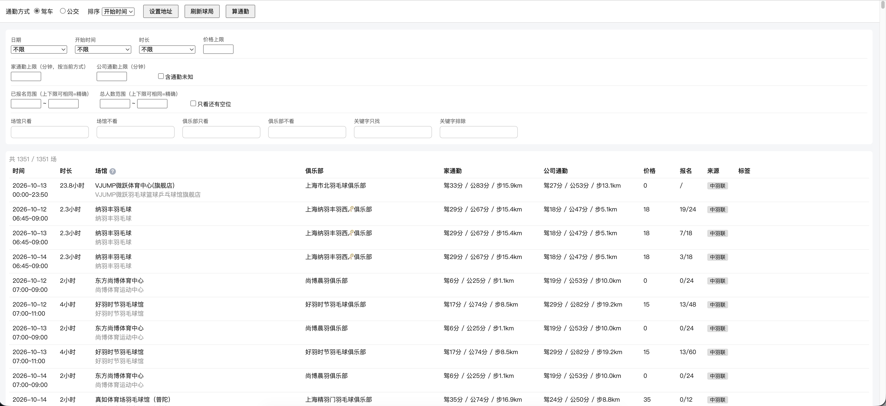
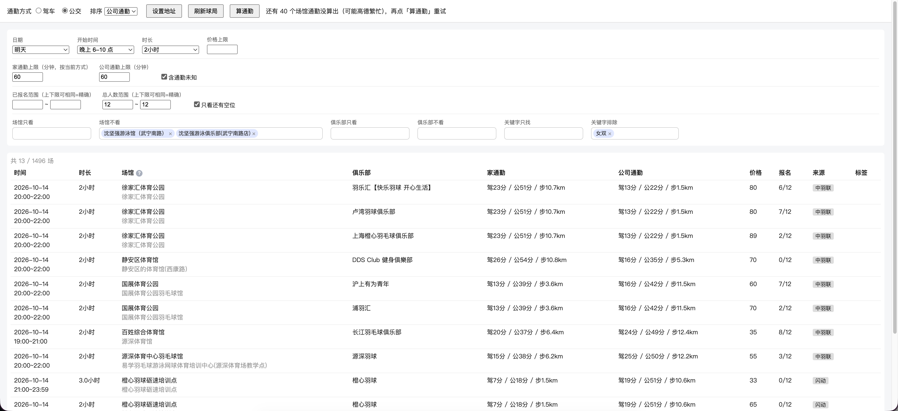

# 羽毛球球局筛选工具

把 **中羽联** 和 **闪动FlashX** 两个微信小程序上的羽毛球球局,聚合到本地,用**自己的条件**筛选排序——两个小程序自带的筛选太弱(尤其没法按真实通勤时间筛),这个工具把球局拉到本地 SQLite,在网页里即时筛选,再回原小程序报名。

> 单人本地自用工具,**仅在 macOS 上验证过**(抓凭证依赖桌面版微信)。运行后浏览器打开 `localhost`, 上面是筛选, 下面是球局列表, 可排序、看详情。注意: 报名仍回原平台。



筛选示例:明天晚上 6–10 点、2 小时、家和公司通勤都不超过 60 分钟、12 人局、只看有空位,排除指定场馆和「女双」,1496 场里筛出 13 场。



## 功能

- **聚合两平台**:中羽联(今天/明天/后天)+ 闪动(今天起 3 天)的球局拉到一个本地库。
- **真实通勤**:调高德地图算**家**和**公司**两个出发地的 **驾车 / 公交 / 步行** 通勤(平台自带的"距离"不准)。公交按傍晚 18:00 出发计算(避免午夜按停运算)。
- **丰富筛选**(本地即时,改条件零延迟):日期、开始时间档、时长档、价格、已报名/总人数范围、只看有空位、家/公司通勤上限、场馆(只看·不看)、俱乐部(只看·不看)、关键字(只找·排除)。筛选条件自动存库,打开页面即恢复;场馆/俱乐部/关键字下拉支持全拼、首字母匹配。
- **多维排序**:点任意列表头排序,再点切换升/降序(未知值始终排最后)。
- **场馆自动归一**:每个平台馆名自动搜高德 POI 归到"统一球场",两平台不同叫法若指向同一 POI 自动归并、共享通勤缓存。
- **球馆管理页**(`/venues`):集中处理未归类和可疑的自动归类(分店不同 / 专名差异大 / 闪动坐标与 POI 相距超过 1km),可确认无误、改归到已有统一球场或另选高德 POI、高德搜不到时手动指定坐标(高德或百度坐标,或整条粘贴百度地图网页链接,百度坐标自动换算)、标记高德搜不到;每次操作都可撤销;手动结果不会被自动归类覆盖。
- **半自动凭证**:凭证失效时点按钮,临时拉起 mitmdump 抓一次微信流量拿新凭证。
- **拉取与算通勤分离**:两个独立按钮,都在后台线程跑、不阻塞界面,状态栏显示 XX/YY 进度;通勤按场馆缓存,只补缺失、不重复烧高德额度。

## 技术栈

Python 3.12+ / Flask / 标准库 sqlite3 / 原生 HTML+JS(无前端框架)。环境用 [uv](https://docs.astral.sh/uv/) 管理。抓包用 [mitmproxy](https://mitmproxy.org/)。

## 目录结构

```
app.py               Flask 路由(薄:拉取入库 / 返回球局 / 算通勤 / 抓凭证)
db.py                SQLite 建表
platforms/
  zhongyulian.py     中羽联 抓取 + 解析归一化
  flashx.py          闪动   抓取 + 解析归一化
venues.py            馆名规范化 + 可疑归类规则(纯函数)
commute.py           高德:地理编码 / POI 搜索 / 驾车·公交·步行
sync.py              刷新编排 + 场馆归类(馆名→高德 POI) + 后台算通勤 + 管理页数据
creds.py             凭证读写(0600) + mitmdump 抓包
static/
  index.html         球局页(筛选 / 排序 / 详情 / 刷新 / 抓凭证)
  venues.html        球馆管理页
  common.js          两页共用(请求 / 转义 / 拼音缓存),ES 模块
  filters.js         筛选、排序、候选推荐纯函数(node 可测),ES 模块
  app.css            全站样式(设计变量 + 原生元素默认样式)
docs/                设计文档与实现计划
```

## 安装与运行

```bash
# 1. 依赖
uv sync                         # 装 Python 依赖
brew install mitmproxy          # 抓凭证用(或 uv tool install mitmproxy)

# 2. 高德 Web 服务 API key(放环境变量；申请见下)
export GAO_DE_MAP_API_KEY=你的key

# 3. 启动(浏览器自动打开 http://localhost:8765)
uv run app.py
```

**4. 桌面版微信(抓凭证前置)**:凭证是靠拦截**桌面版微信**的流量抓到的,所以先装 **桌面版微信**(macOS)并登录,在里面各打开一次「**中羽联**」和「**闪动FlashX**」两个小程序(搜到、进去过,后面好找)。首次「抓取凭证」时需要在桌面微信里刷这两个小程序,流量才会被 mitmdump 捕获。

### 高德 key 怎么来

到[高德开放平台](https://lbs.amap.com/) 注册 → 创建应用 → 添加 **Web 服务** 类型的 key。用到的接口(地理编码、POI 搜索、路径规划)**有每月免费额度**,个人自用完全够(超出额度才计费)。

## 首次使用

1. **设置地址**:点顶栏「设置地址」,填**家**和**公司**的文字地址(工具自动调高德拿坐标)。
2. **抓凭证**:首次点「刷新球局」会提示凭证失效 → 点「抓取凭证」→ 按提示在**桌面微信**里**打开中羽联、闪动两个小程序各刷一下列表**。
3. **刷新球局**:点「刷新球局」拉两平台球局. 全部拉完需要1分多钟时间
4. **算通勤**:点「算通勤」后台计算各球馆到家/公司的通勤(第一次场馆多, 要几分钟, 边算边回填; 之后走缓存很快)。
5. **筛选 / 排序 / 看详情**,选好后回对应小程序按 日期+场馆 找到那条报名。

## 已知限制与坑

- **中羽联的经纬度不可信**,一律不用(见 `CLAUDE.md`)。中羽联球馆坐标只靠高德搜名字来定;高德搜不到的馆通勤显示「未知」,不用中羽联坐标兜底。
- **高德 Web 服务 API 的 POI 覆盖 < 消费者地图**:个别馆(如"健兴泓体育中心")网页版高德搜得到、`/v3`·`/v5` place/text 却返回空,这种馆就没有统一名、通勤可能算不出,属数据源缺口;可以在球馆管理页从高德/百度坐标拾取器复制坐标、或粘贴百度地图网页链接手动指定(拾取器未登录认证只显示 2 位小数,精度不够会被拒;高德网页链接里没有坐标)。闪动球局因自带坐标,即使搜不到名字通勤仍可算。
- **不做跨平台球局去重**:同一场发在两平台会显示两行(同场馆+同时间也可能是真的不同局,合并风险大,故不合并)。
- **凭证会过期**(闪动约 7 天),过期需重新「抓取凭证」。
- **活动 id 仅供核对**,不能直接在小程序里搜;回平台报名靠 日期+场馆+标题 定位。
- **单用户、本地、无鉴权**(Flask 默认绑 127.0.0.1)。

## 数据存储(本地 SQLite `games.db`)

`games`(球局,`lat`/`lng` 只存平台原始坐标)、`venue_aliases`(规范化馆名 → 统一球场,带来源:待归类/自动/已确认/手动/高德搜不到)、`canonical_venues`(统一球场 = 一个高德 POI:名称、POI id、坐标;手动指定坐标的没有 POI id)、`commute`(按"出发地×场馆"缓存的驾/公/步)、`origins`(家/公司地址与坐标)、`kw_history`(用过的关键字,行永不删=永久下拉候选)、`filters`(当前整份筛选条件,单行 JSON)。

## 测试

```bash
uv run pytest -q          # 后端
node tests/filters.test.mjs  # 前端筛选/排序纯函数
```

## 隐私

`creds.json`(登录态,0600)、`games.db`(含家/公司地址等本地数据)、`*.mitm`(抓包流量)都已在 `.gitignore`,不会入库。
